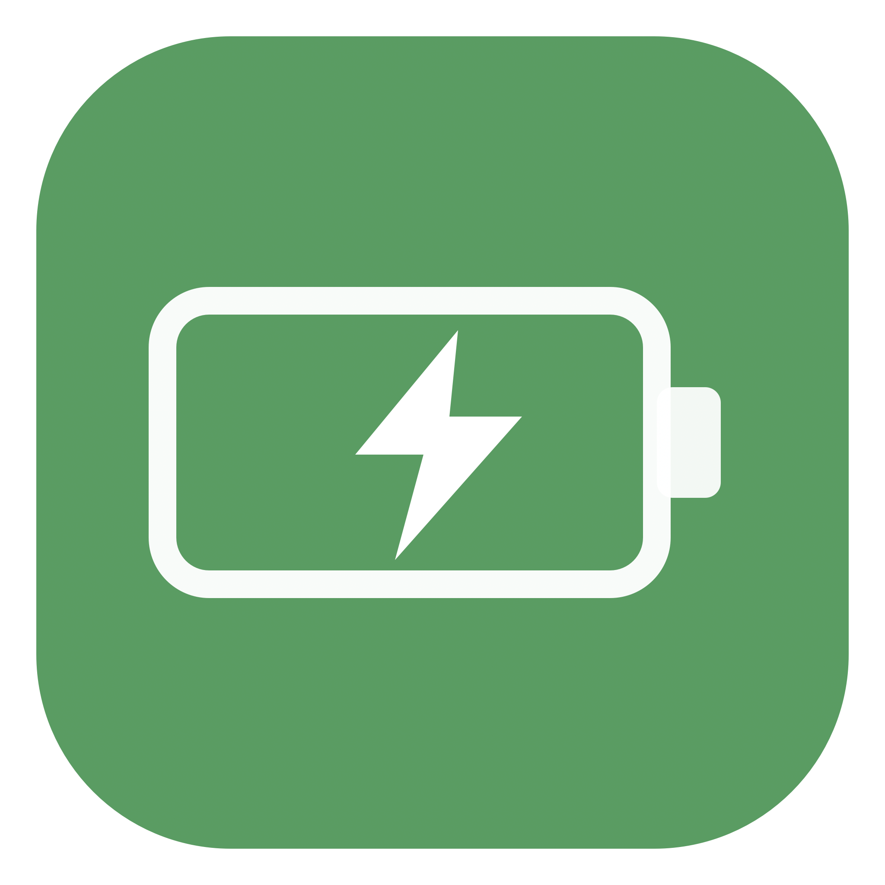
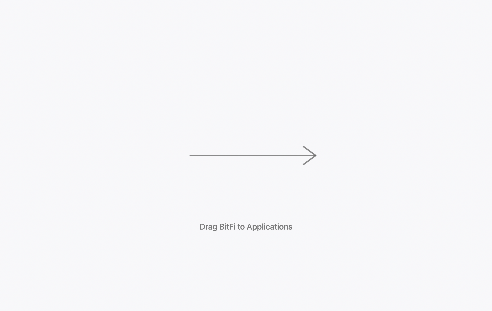

# BitFi

<p align="center">
  
</p>

<p align="center"><strong>Native macOS battery monitoring, honest charge care.</strong></p>

<p align="center">
  
</p>

Native macOS battery monitor with charge-threshold reminders. Built with Swift, SwiftUI, IOKit, ServiceManagement, UserNotifications. No Electron, web views, private charger APIs, privileged helpers, dependencies.

## What works

- Live battery percentage, charge state, power source, time estimates, health, condition, temperature, voltage, current, cycle count when macOS reports each field.
- Battery health condition plus maximum-capacity percentage when macOS publishes design capacity.
- Automatic IOKit power-source updates, wake refresh, menu bar extra with correctly level-matched battery glyph and live percentage.
- Persistent 50–100% custom threshold; 70%, 80%, 85%, 90% presets.
- Real local notification at threshold. `Charge to 100% This Session` pauses reminder until power disconnects.
- Login-at-login via `SMAppService.mainApp`.
- Native settings: General, Battery, Menu Bar, Notifications, About.
- Navigable local battery-history chart: 1D, 1W, 1M, 6M, 1Y, and complete-history ranges; horizontal pan, range navigation, hover inspection. Samples survive quits, restart, and shutdown for up to two years. Line joins adjacent recorded samples without inventing missing readings.
- Menu bar panels: Status, 24-hour battery history, App Activity.
- App Activity pie modes: real CPU activity, resident memory, and actual device battery level. CPU/memory refresh every two seconds only while their chart is visible.

## Important limitation

Public macOS APIs expose battery monitoring, not arbitrary hardware charge caps. BitFi never claims to stop charging; it provides honest threshold reminders so user can unplug power. It does not modify firmware or use undocumented IORegistry controls.

Public macOS APIs also do not expose per-app battery-energy use. BitFi labels CPU and memory as workload metrics; `Battery Level` is device state-of-charge, not invented per-app energy data. Use the working Activity Monitor shortcut for macOS’s real per-process Energy Impact.

## Requirements

- macOS 14 Sonoma or later
- Xcode 15 or later

## Build and run

1. Open `BitFi.xcodeproj` in Xcode.
2. Select `BitFi` scheme, then **Run**.
3. If Xcode asks for signing, choose local development team for installed builds.

Command-line compile check:

```sh
swift build
```

## Project layout

```text
BitFi/
  Models/       Battery snapshot domain model
  Services/     IOKit monitor, reminders, notifications, settings, login item
  Views/        SwiftUI window, menu bar, settings
  Resources/    App metadata
```

## Release

Release DMG build:

```sh
Scripts/build_release_dmg.sh 1.2.3
```

Creates `Artifacts/BitFi-1.2.3-universal.dmg`: Apple-silicon + Intel executable, branded Finder artwork, flat green BitFi battery-and-bolt icon, Applications shortcut. Build is ad-hoc signed; release builds need Developer ID signing and notarization before broad distribution.
